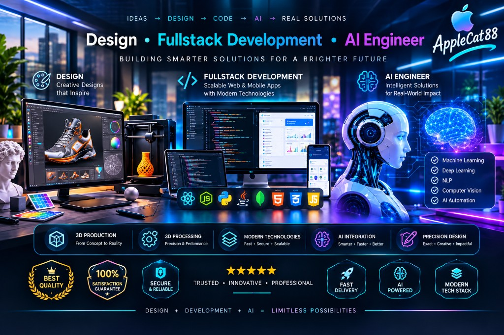
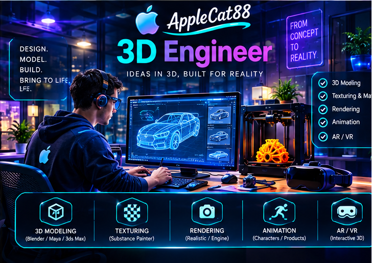
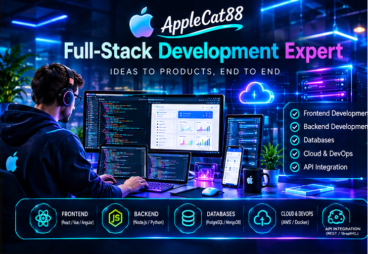
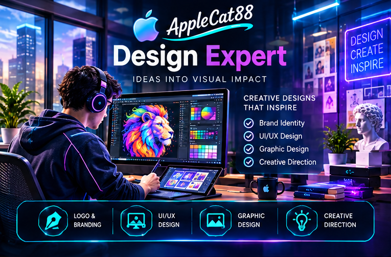
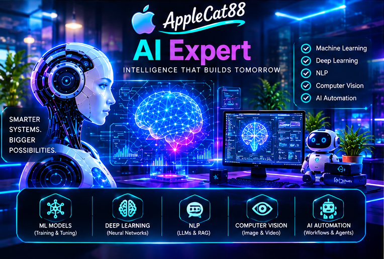

  

  
  
  
  

The same bench runs from a machined part to a working product. The work is 3D production and processing, full-stack software with AI inside it, a design built to the drawing, and those pieces joined so a person gets a result they can use.

| | |
| --- | --- |
| **3D production** | A digital model taken through machining, printing, and the processing that finishes the part |
| **Full-stack** | The application from the screen through the services, with a model in the path |
| **Design** | Layout, materials, and a build that matches the drawing |
| **AI integration** | The model wired into the product, with a result on the surface a person actually uses |

## Badges

Every GitHub achievement, at its highest image.

<table align="center">
  <tr>
    <td align="center" width="150">
       
      <b>Pair Extraordinaire</b> Gold
    </td>
    <td align="center" width="150">
       
      <b>Pull Shark</b> Gold
    </td>
    <td align="center" width="150">
       
      <b>Galaxy Brain</b> Gold
    </td>
  </tr>
  <tr>
    <td align="center">
       
      <b>Starstruck</b> Gold
    </td>
    <td align="center">
       
      <b>Heart On Your Sleeve</b> Gold
    </td>
    <td align="center">
       
      <b>Open Sourcerer</b> Gold
    </td>
  </tr>
  <tr>
    <td align="center">
       
      <b>Quickdraw</b>
    </td>
    <td align="center">
       
      <b>YOLO</b>
    </td>
    <td align="center">
       
      <b>Public Sponsor</b>
    </td>
  </tr>
  <tr>
    <td colspan="3" align="center">
      <table>
        <tr>
          <td align="center" width="150">
             
            <b>Arctic Code Vault</b>
          </td>
          <td align="center" width="150">
             
            <b>Mars 2020</b>
          </td>
        </tr>
      </table>
    </td>
  </tr>
</table>

  The profile shows a badge only after GitHub awards it. Arctic Code Vault and Mars 2020 are closed events. Gold for stars, co-authored work, and accepted answers comes from other people.

## 3D production

  

A part is planned as geometry, then cut, printed, and finished. Toolpaths, lattices, and the fixture under the work stay in one process.

  
  
  
  

## Full-stack

  

JavaScript and React on the front, Node behind it, and Dart with Flutter when the product is a mobile app. The model sits in that stack, so the interface and the logic stay in step.

  
  
  
  
  

  

## Design

  

The grid, the material, and the object are one study. Spacing, color, and form are decided together, then built to the same measures.

  
  
  
  

  

## AI integration

  

The model, the data it can see, and the place in the product where a result appears. The path runs from the core to the surface, and a person gets an answer they can use.

  
  
  
  

  

## Profile

  
  

