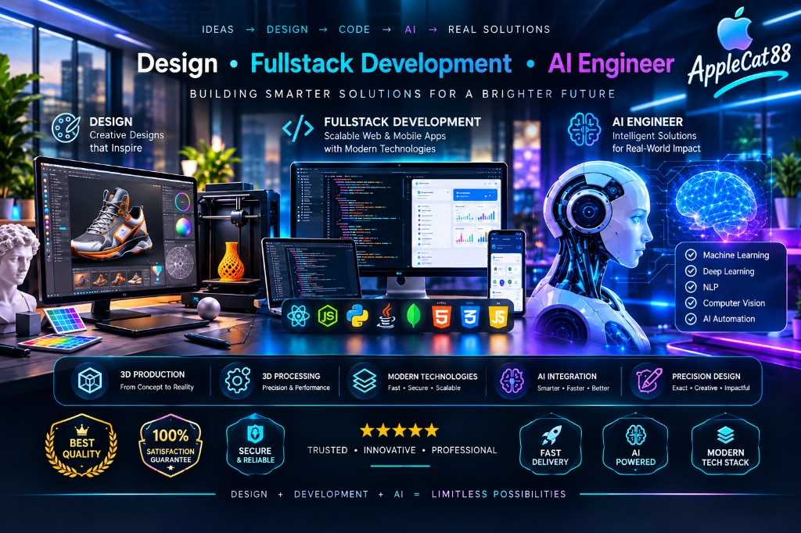
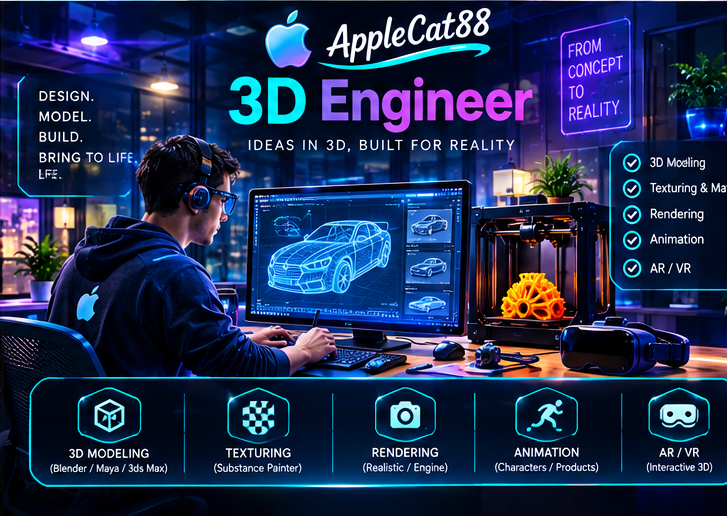
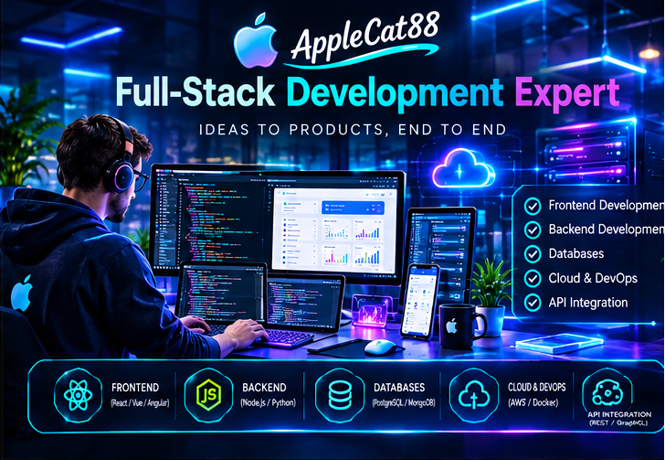
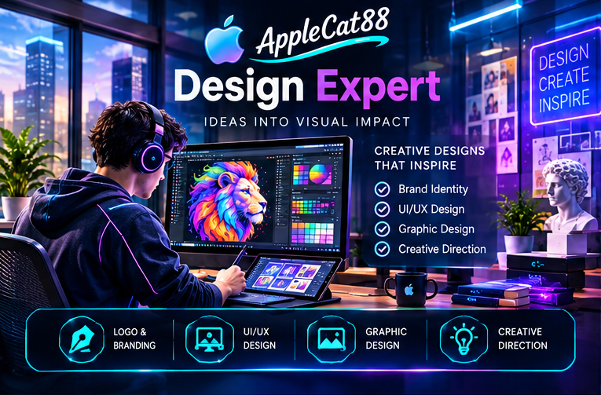
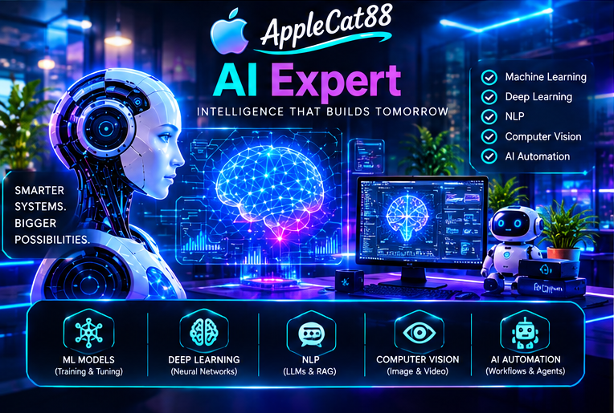



  

  
  
  
  

<h2 align="center">From Concept to Completion — Engineering, Design, Software &amp; AI</h2>

I specialize in transforming ideas, technical concepts, and design requirements into complete, high-quality products. My expertise spans **3D engineering and manufacturing**, **full-stack software development**, **product and interface design**, and **practical AI integration**.

What sets this approach apart is connecting those disciplines into one cohesive development process. Engineering, design, software, and AI are not treated as separate tasks — they are brought together so the result is functional, technically sound, visually refined, and ready for real-world use.

| | |
| --- | --- |
| **3D Engineering** | Digital modeling through machining, additive manufacturing, and finishing |
| **Full-Stack** | Interfaces, application logic, backend services, and AI-powered features |
| **Product Design** | Layout, materials, usability, and design-to-build implementation |
| **AI Integration** | Models wired into products so intelligence becomes a usable outcome |

## 3D Engineering & Digital Manufacturing

  

I work across the complete 3D production workflow — from digital modeling and geometric development to machining, additive manufacturing, and post-processing. Precision, practical engineering judgment, and production-aware design turn digital concepts into accurately manufactured physical components.

**Core capabilities:** 3D modeling · CAD development · CNC machining · additive manufacturing · toolpath planning · lattice structures · fixtures · post-processing

  
  
  
  

  

  Blender · AutoCAD · SketchUp · Three.js

## Full-Stack Software Development

  

I build software with a full-stack perspective — connecting intuitive interfaces with robust application logic, backend services, and AI-powered functionality. Work spans modern web technologies and mobile frameworks, with emphasis on maintainable architecture, seamless integration, and reliable end-to-end performance.

**Core technologies:** JavaScript · React · HTML · CSS · Node.js · Dart · Flutter · Git · GitHub

  
  
  
  
  
  
  
  
  

  

  JavaScript · HTML · CSS · React · Node.js · Dart · Flutter · Git · GitHub

## Product Design & Technical Implementation

  

Design is more than visual presentation. Layout, proportions, materials, color, usability, and technical constraints must work together as one product. From early studies and interface layouts to material selection and physical implementation, the goal is to translate design intent into tangible results — keeping consistency between the original concept and the finished build.

**Core capabilities:** UI/UX design · layout development · material selection · visual design · design systems · technical drawings · design-to-build implementation

  
  
  
  
  
  

  

  Figma · Photoshop · Illustrator · HTML · CSS · VS Code

## AI Integration & Intelligent Applications

  

I integrate AI and large language models into practical software products — connecting models, application data, backend services, and user-facing interfaces. The focus is making AI genuinely useful inside a product: not simply adding a model or chatbot, but designing the full workflow through which intelligence becomes an accessible, relevant, and actionable result for the end user.

**Core capabilities:** LLM integration · Python · AI-powered applications · model-to-product integration · data workflows · applied AI development

  
  
  
  
  
  

  
  
  

  Python · PyTorch · TensorFlow · Hugging Face · Linux · VS Code

## Complete Solutions, Not Isolated Tasks

High-quality work comes from understanding the entire process and taking responsibility for how all its parts fit together.

Whether the project is a precision-manufactured component, a complete software application, an integrated AI system, or a combination of physical and digital technologies, the focus stays on the finished outcome — not only an individual stage.

Technical precision, thoughtful design, clear communication, and attention to detail matter throughout. Every element should serve a purpose, every component should work together, and the final result should meet the intended requirements.

**Commitment:** turn ideas into complete, well-engineered, thoughtfully designed, and fully functional results.

## Profile

  
  

