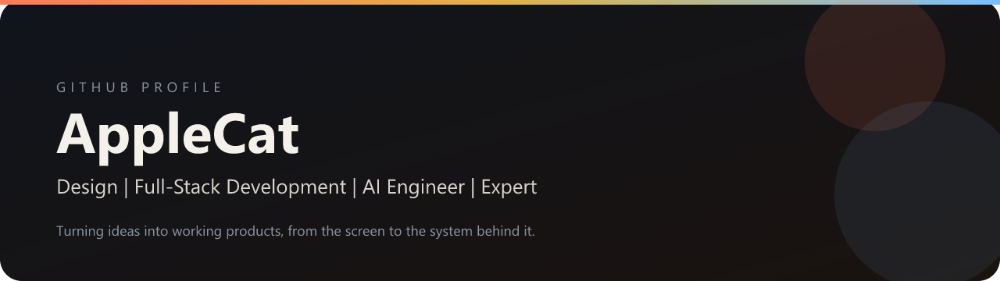

  

  
  
  
  

I’m here to help turn an idea into something real. The work covers the screen, the product, the code, and the engineering behind it.

## Badges

Every GitHub achievement, at its highest image.

<table align="center">
  <tr>
    <td align="center" width="150">
       
      <b>Pair Extraordinaire</b> Gold
    </td>
    <td align="center" width="150">
       
      <b>Pull Shark</b> Gold
    </td>
    <td align="center" width="150">
       
      <b>Galaxy Brain</b> Gold
    </td>
  </tr>
  <tr>
    <td align="center">
       
      <b>Starstruck</b> Gold
    </td>
    <td align="center">
       
      <b>Heart On Your Sleeve</b> Gold
    </td>
    <td align="center">
       
      <b>Open Sourcerer</b> Gold
    </td>
  </tr>
  <tr>
    <td align="center">
       
      <b>Quickdraw</b>
    </td>
    <td align="center">
       
      <b>YOLO</b>
    </td>
    <td align="center">
       
      <b>Public Sponsor</b>
    </td>
  </tr>
  <tr>
    <td colspan="3" align="center">
      <table>
        <tr>
          <td align="center" width="150">
             
            <b>Arctic Code Vault</b>
          </td>
          <td align="center" width="150">
             
            <b>Mars 2020</b>
          </td>
        </tr>
      </table>
    </td>
  </tr>
</table>

## Design

Interface, layout, and the visual system of a product. The goal is a screen that is clear before it is decorated: type, spacing, color, and the path a person actually follows.

  
  
  
  

  

## Full-Stack Development

The product from the interface through the application behind it. Front end, application logic, and the pieces that have to stay in sync when someone actually uses it.

  
  
  
  
  

  

## AI Engineer

AI as part of the product, not a demo on the side. That means the model, the prompt, the data it can see, and the place in the interface where a person gets a useful result.

  
  
  
  

  

## Expert

Full-stack work across development, design, engineering, and manufacturing. The job is to take an idea through the decisions that make it hold up: what to build, how it is made, and what ships.

  
  
  
  
  

## Profile

  
  

